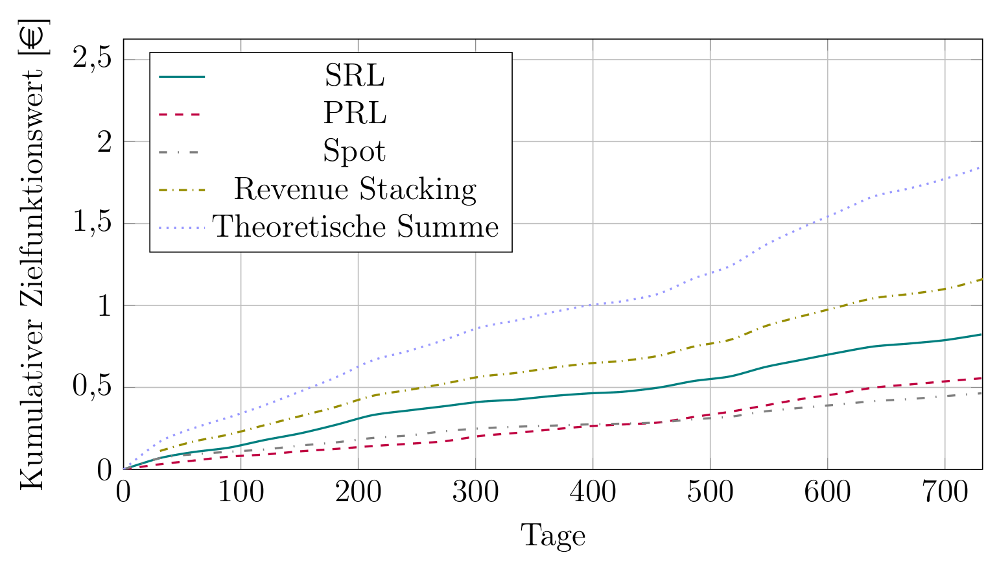
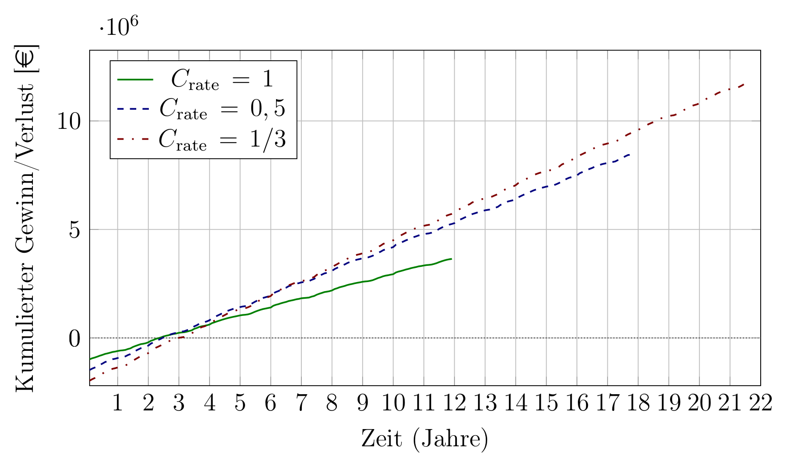
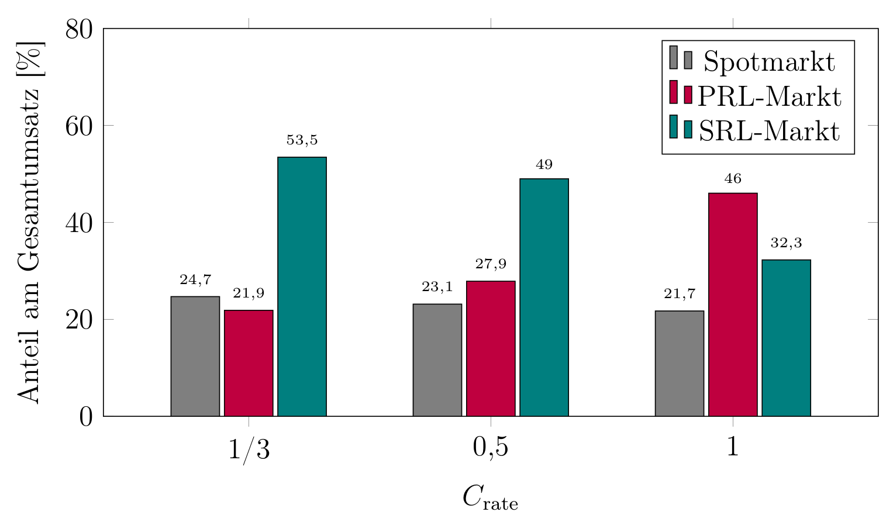

# BESS Trading Optimizer

Optimierungsmodell zur Erlösmaximierung eines Großbatteriespeichers (BESS) am deutschen Strom- und Regelleistungsmarkt, entwickelt mit Python und Pyomo.

Das Projekt entstand im Rahmen unserer Bachelorarbeit (gemeinsam mit Johannes Rohde) an der HTW Berlin (Note 1,0):
*„Entwicklung und Auswertung eines numerischen Modells zur Maximierung des Profits von Großbatteriespeichern am deutschen Strom- und Regelleistungsmarkt“*

## Worum geht es?

Ein Batteriespeicher kann seine Leistung in jedem Zeitpunkt nur einmal vermarkten: entweder im Energiehandel (Day-Ahead, Intraday) oder als Regelleistung (PRL/FCR, SRL/aFRR). Das Modell bestimmt für historische Marktdaten, welche Vermarktung zu welchem Zeitpunkt den höchsten Gewinn bringt, unter Berücksichtigung der technischen Grenzen und der Alterung der Batterie.

## Modell im Überblick

**Ansatz:** Gemischt-ganzzahlige lineare Optimierung (MILP) mit Perfect Foresight, gelöst mit Gurobi.

**Zielfunktion:** Maximierung des Gewinns = Markterlöse − Alterungskosten − Steuern

**Märkte**
- Day-Ahead- und Intraday-Auktion (15-Minuten-Auflösung)
- Primärregelleistung (PRL/FCR) in 4-Stunden-Blöcken
- Sekundärregelleistung (SRL/aFRR), Leistungs- und Arbeitspreis, positiv und negativ
- Marktwahl je Zeitintervall über Binärvariablen (gegenseitiger Ausschluss)

**Technische Modellierung**
- Ladezustand, Lade-/Entladeleistung und Systemwirkungsgrad (Batterie, Wechselrichter, Trafo, Kühlung, Verteilung)
- Kapazitätsdegradation, kalendarisch und zyklisch, abhängig von Ladezustand und C-Rate
- Wirkungsgraddegradation über die Lebensdauer
- Äquivalente Vollzyklen mit SoC-abhängiger Gewichtung, optional Zyklenbegrenzung pro Tag

**Wirtschaftliche Modellierung**
- CAPEX und OPEX, spezifische Alterungskosten pro Zyklus
- Steuern und Abschreibung

**Simulation über die Lebensdauer:** Die Optimierung läuft monatsweise. Batteriekapazität, Wirkungsgrad, Zyklenzahl und Ladezustand werden jeweils in den nächsten Monat übernommen, bis die Restkapazität 80 % (End of Life) erreicht.

## Projektstruktur

```
├── api/                 # Datenabruf über die ENTSO-E-Transparenzplattform
├── dataloader/          # Einlesen und Aufbereiten der Marktdaten
├── model/
│   ├── constraints/     # Nebenbedingungen (Märkte, PRL, SRL, Zyklen, Degradation …)
│   ├── expressions/     # Erlöse, Alterungskosten, Steuern …
│   ├── model_builder.py # Aufbau und Lösen des Pyomo-Modells
│   └── objective.py     # Zielfunktion
├── params/              # Szenario-Konfiguration (Batterie, Kosten, Märkte)
├── result_processing/   # Extraktion und Export der Ergebnisse
├── results/             # Grafiken für diese README
├── scripts/             # Pipelines: Daten laden, optimieren, visualisieren
├── visualization/       # Auswertungsgrafiken
├── config_degradation.py
└── cost_calculator.py
```

Namenskonventionen für Variablen, Parameter und Constraints sind in [NAMING.md](NAMING.md) beschrieben.

## Ergebnisse

Untersucht wurde ein 3-MW-Speicher mit unterschiedlichen C-Raten (1, 0,5 und 1/3) auf Basis der Marktdaten von 2023 und 2024.

**Revenue Stacking lohnt sich:** Die kombinierte Vermarktung über alle Märkte erzielt über zwei Jahre rund 41 % mehr als die profitabelste Einzelvermarktung (SRL).



*Kumulativer Zielfunktionswert in Mio. € (C-Rate 0,5): Einzelmärkte im Vergleich zum Revenue Stacking*

**Die C-Rate ist entscheidend:** Ein System mit C-Rate 0,5 bietet den besten Kompromiss aus Investitionskosten, Amortisationszeit und Gesamtprofit. Eine größere Kapazität (C-Rate 1/3) bringt nur noch wenig zusätzlichen Ertrag.



*Kumulierter Netto-Cashflow über die Lebensdauer: Der Nulldurchgang markiert die Amortisation, der Endwert den Gesamtprofit.*

Mit sinkender C-Rate verschiebt sich der Umsatz vom PRL- zum SRL-Markt, der bei den größeren Speichern den Hauptanteil der Erlöse liefert.



Da das Modell mit Perfect Foresight arbeitet, zeigen die Ergebnisse das theoretische Erlöspotenzial. Sie eignen sich als Benchmark für Prognose- und Handelsmodelle im realen Betrieb.

## Grenzen des Modells

Das Modell ist bewusst vereinfacht, damit es als gemischt-ganzzahliges lineares Problem lösbar bleibt. Die wichtigsten Einschränkungen:

- **Perfect Foresight:** Alle Preise sind im Voraus bekannt. Die Ergebnisse sind daher eine Obergrenze und keine Prognose für den realen Betrieb.
- **Monatsweise Optimierung:** Jeder Monat wird einzeln gelöst und der Zustand übergeben. Am Monatsende gibt es keine Vorgabe für den Ladezustand.
- **Konstante Parameter innerhalb eines Monats:** Wirkungsgrad und Kapazität gehen pro Monat als feste Werte in die Energiebilanz ein und werden erst im Folgemonat aktualisiert.
- **Vereinfachte SRL-Aktivierung:** Die Batterie gilt als abgerufen, sobald der Arbeitspreis (CBMP) über einer Schwelle aus Alterungskosten und Gewinnfaktor liegt, und liefert dann für die ganze Viertelstunde die volle angebotene Leistung. Tatsächliche Abrufmengen werden nicht abgebildet.
- **Alterung:** Die kalendarische Alterung wird in der aktuellen Umsetzung nicht über die Zeit aufsummiert, die Lebensdauer wird dadurch eher überschätzt. Der Einfluss der C-Rate auf die Kapazitätsdegradation wirkt nur je Zeitschritt und ist dadurch sehr gering.
- **Solver-Toleranz:** Gurobi löst mit einer MIP-Lücke von 5 %. Unterschiede zwischen Szenarien in dieser Größenordnung sind nicht belastbar.
- **Steuern:** Vereinfacht mit 20 %, monatlich berechnet und ohne Verlustvortrag.

Mögliche Weiterentwicklungen sind eine kumulierte kalendarische Alterung, eine realistischere Abbildung der SRL-Abrufe und eine Optimierung mit Preisprognosen statt Perfect Foresight.

## Nutzung

```bash
pip install -r requirements.txt
```

Voraussetzungen:
- Gurobi mit gültiger Lizenz (für Studierende kostenlos)
- Marktdaten im Ordner `data/` (nicht im Repository enthalten, siehe unten)
- Für den Datenabruf: ENTSO-E-API-Key als Umgebungsvariable `ENTSOE_API_KEY`

Szenario in `params/scenario_config.py` anpassen, dann:

```bash
python -m scripts.optimisation_backtest
python -m scripts.visualisation_pipeline
```

Die Optimierung speichert ihre Ergebnisse unter einem zufälligen Namen (z. B. `results/CRate_0.5_a1b2c3d4.pkl`). Für die Visualisierung müssen die Dateien vorher umbenannt werden: `all.pkl` für das Revenue Stacking sowie `market.pkl`, `prl.pkl` und `srl.pkl` für die Läufe mit jeweils nur einem Markt.

## Datenquellen

Die Rohdaten sind aus Lizenz- und Größengründen nicht im Repository enthalten. Verwendet wurden:
- Day-Ahead- und Intraday-Preise: Energy-Charts (Fraunhofer ISE)
- PRL- und SRL-Ausschreibungsergebnisse: regelleistung.net
- SRL-Arbeitspreise (aFRR): ENTSO-E-Transparenzplattform
- SRL-Sollwerte: Netztransparenz.de

## Technologien

Python · Pyomo · Gurobi · pandas · NumPy · matplotlib · seaborn · entsoe-py
